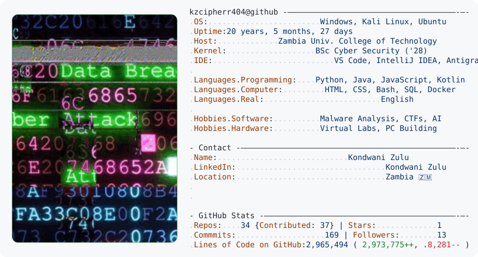

  <a href="https://github.com/kzcipherr404">
    <picture>
      <source media="(prefers-color-scheme: dark)" srcset="https://raw.githubusercontent.com/kzcipherr404/kzcipherr404/main/dark_mode.svg">
      
    </picture>
  </a>

 

# Kondwani Zulu

### 🛡️ Cybersecurity Student · 💻 Developer · 🤖 AI Builder

📍 **Zambia 🇿🇲** &nbsp;|&nbsp; 🎓 **Zambia University College of Technology** &nbsp;|&nbsp; 🎯 **Class of 2028**

*"Learn. Build. Break. Understand. Repeat."*

---

### 👨‍💻 About Me

I'm a Cybersecurity student at **Zambia University College of Technology** with a strong interest in offensive/defensive security, software development, artificial intelligence, and building practical systems.

- 🔍 Exploring how systems work under the hood and dissecting malware in isolated lab environments.
- ⚙️ Automating security workflows, network scanning, and building backend APIs with Python.
- 🏆 Preparing for **MITRE eCTF 2027** and actively tackling CTF challenges.
- 🎨 Balancing deep technical pursuits with creative design, UI/UX, and digital art.

---

### 🛠️ Technical Stack

| Category | Technologies & Tools |
| :--- | :--- |
| **Languages** | Python, Java, JavaScript, Kotlin, HTML, CSS, SQL, Bash |
| **Cybersecurity Tools** | Kali Linux, Nmap, Wireshark, Burp Suite, Digital Forensics, Malware Analysis |
| **Malware Analysis Lab** | VirtualBox, FLARE-VM, Regshot, FakeNet-NG, PE Bear, Detect It Easy |
| **Frameworks & Backend** | FastAPI, Flask, Django, Supabase |
| **DevOps & Infrastructure** | Docker, Git, GitHub, Linux (Kali / Ubuntu), Windows 11 |
| **Cloud & Deployment** | Cloudflare Pages, Render |

---

### 🔐 Cybersecurity & Research Focus

- 🧪 **Malware Analysis & Forensics**: Controlled static and dynamic malware research in isolated virtual machines.
- 🌐 **Network Security & Pentesting**: Ethical hacking, vulnerability research, and active protocol inspection.
- 🤖 **Security Automation & AI**: Developing intelligent tooling for reconnaissance and automated security tasks.
- 🔒 **Embedded Systems Security**: Exploring firmware and hardware-level security in preparation for MITRE eCTF.

---

### 🚀 Projects

- 🛡️ **Cybersecurity & Malware Analysis Lab**: Controlled research environment using VirtualBox, FLARE-VM, Wireshark, and dynamic analysis tools.
- 📡 **Network Scanner API**: Automated security tool for active host discovery and port scanning with FastAPI.
- 📊 **Excelflow AI**: Spreadsheet automation exploring AI-assisted productivity workflows.
- 🎨 **Ubuart**: Modern digital art portfolio platform showcasing Zambian artists with authentication and media galleries.
- 📱 **LocalCrafts Android App**: Native mobile application developed with Kotlin for local craft artisans.
- ⚡ **Personal Portfolio Website**: Online portfolio built with Flask showcasing projects and research.

---

### 📫 Connect With Me

- **GitHub**: [@kzcipherr404](https://github.com/kzcipherr404)
- **LinkedIn**: [Kondwani Zulu](https://linkedin.com/in/kzcipherr404)
- **Location**: Zambia 🇿🇲
